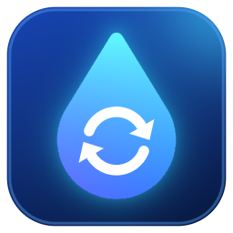
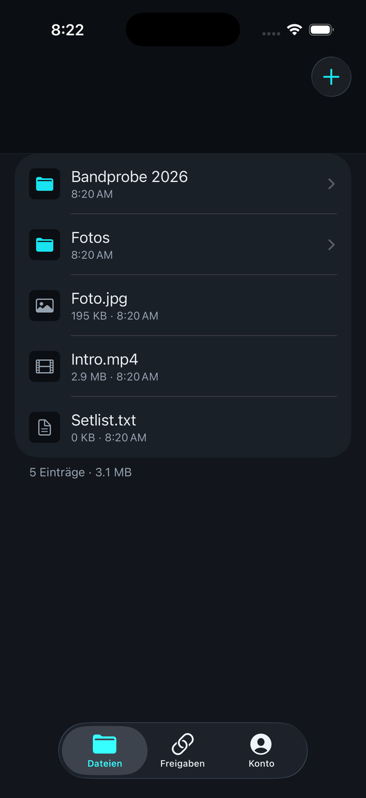
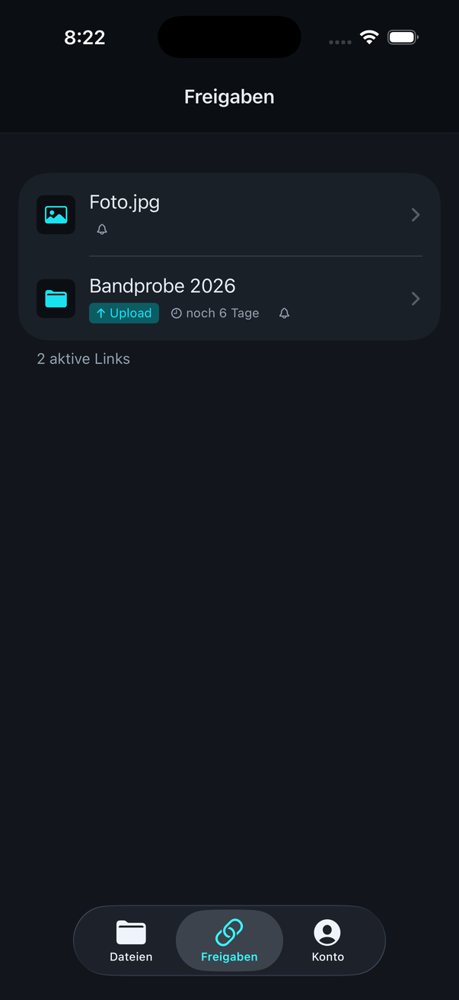
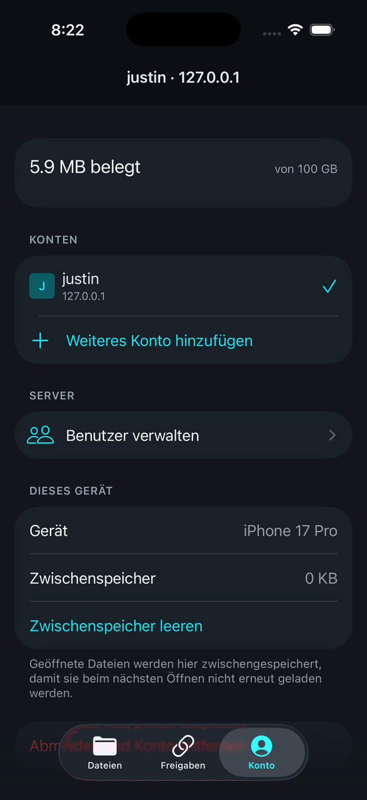

<div align="center">

<h1>&nbsp;DropCraft</h1>

**Your own Dropbox: a self-hosted file sync server with apps for Windows, macOS and iOS, written in Rust.**

Separate storage and quotas per account on your own server, a tray app with files on demand
and an Explorer menu, share links with a web gallery, a web app and a native iPhone app.

[](https://github.com/JustinSchweiger/DropCraft/actions/workflows/ci.yml)
[](https://github.com/JustinSchweiger/DropCraft/releases/latest)
[](https://github.com/JustinSchweiger/DropCraft/releases)


[Download](https://github.com/JustinSchweiger/DropCraft/releases/latest) ·
[Features](#features) ·
[Install](#install) ·
[Docs](#documentation) ·
[Build](#build-from-source)

</div>

> [!NOTE]
> DropCraft is an independent project and not affiliated with Dropbox, Inc.

## Features

|  |  |
|---|---|
| ☁️ **Files on demand** | On Windows the sync folder is a real cloud folder: files appear as placeholders and download when opened, with a status column, *Always keep on this device* and *Free up space* |
| 🔄 **Sync** | Change feed with cursors, conflict copies (`Name (Konflikt Gerät Datum).ext`), deletions that reach every device, bandwidth limits and an instant pause |
| 👥 **Multiple accounts** | Each with its own server, sign-in and sync folder (for example `DropCraft` and `DropCraft ocv`) |
| 🔗 **Share links** | A web page with gallery and preview for photos and videos, single downloads or everything as ZIP; optional guest upload, password, expiry date and notifications |
| 🖱️ **Explorer menu** | Right-click › **DropCraft** in the Windows 11 menu: *DropCraft-Link kopieren*, *Freigeben …*, *Im Browser anzeigen*; plus own folder icons and a cloud folder in the navigation pane |
| 🖥️ **Tray app** | A popup above the taskbar (menu bar on macOS) with live progress, speed and time left; starts silently with Windows |
| 📱 **iPhone & iPad** | Native SwiftUI app: browse, preview, upload from Photos and Files, manage links and users |
| 🌐 **Web app** | Installable web app under `/app/` for any browser |
| 🛡️ **Account website** | `/account` on your server: storage, password, signed-in devices and share links for everyone; users, quotas, disabling accounts and server settings for admins. One click from the apps, already signed in |
| 🌍 **English & Deutsch** | The Windows and macOS app, the Explorer menu, the web app and the account website in English (default) or German |
| 🔄 **Install & updates** | `DropCraft.exe` installs itself without admin rights and keeps itself up to date |
| 🐳 **Server** | axum + SQLite, files stored as blobs per account, Docker with Caddy for automatic HTTPS, deployed by GitHub Actions |
| 🎵 **Musik-Check** | Bonus page that checks spliced music files for loudness (EBU R128), clipping and cuts, entirely in the browser |

## Screenshots

<table>
  <tr>
    <td width="33%"><br><sub><b>Files</b>: browse and preview</sub></td>
    <td width="33%"><br><sub><b>Links</b>: guest upload, expiry, notifications</sub></td>
    <td width="33%"><br><sub><b>Account</b>: storage, accounts, users</sub></td>
  </tr>
</table>

## Install

Every green CI run on `main` publishes a release with all apps. Installed apps update themselves.

<details open>
<summary><b>Windows</b></summary>

Download **`DropCraft-Windows.exe`** from the
**[latest release](https://github.com/JustinSchweiger/DropCraft/releases/latest)** (or from
your server's start page) and double-click it.

- It asks to install itself to `%LOCALAPPDATA%\Programs\DropCraft`: no administrator rights,
  an entry under *Settings › Apps*, the Start menu and *start with Windows* (silently, in the tray).
- It then offers the **Explorer menu**. Windows 11 only shows signed packages there, so DropCraft
  signs a small package with a certificate of its own and Windows asks once for admin rights to
  trust it. Details in [WINDOWS.md](docs/WINDOWS.md#explorer-menu).
- The file is not code-signed. If SmartScreen warns, choose **More info › Run anyway**.
- `DropCraft-Windows-ohne-Cloud-Dateien.exe` is the variant that always downloads every file.
</details>

<details open>
<summary><b>macOS</b></summary>

Download `DropCraft-macOS.zip`, unzip it and drag DropCraft into *Applications*. The app is not
notarized: on first launch right-click › *Open*, or run

```sh
xattr -dr com.apple.quarantine /Applications/DropCraft.app
```

It lives in the menu bar. Files on demand and the Finder menu are not available on the Mac yet.
</details>

<details open>
<summary><b>iPhone & iPad</b></summary>

Install with Xcode and a free Apple ID, or sideload the unsigned `DropCraft-iOS.ipa` with
SideStore, AltStore or Sideloadly. See [IOS.md](docs/IOS.md).
</details>

<details open>
<summary><b>Server</b></summary>

On a fresh Debian or Ubuntu VPS, as root:

```sh
git clone https://github.com/JustinSchweiger/DropCraft.git /opt/dropcraft
cd /opt/dropcraft/deploy && ./setup.sh cloud.example.com   # without a domain: ./setup.sh
docker compose exec -it dropcraft dropcraft-server adduser justin 100 --admin
```

Caddy gets the HTTPS certificate automatically. Everything else (users, quotas, links, server
settings) is managed at `https://<your-domain>/account`. See [SERVER.md](docs/SERVER.md) for
deployment, backups and n8n.
</details>

## Documentation

| Guide | Topic |
|---|---|
| [WINDOWS.md](docs/WINDOWS.md) | The Windows app: tray popup, files on demand, Explorer menu, installer, command line |
| [SERVER.md](docs/SERVER.md) | Running the server: VPS setup, account website, settings, deployment, backups, n8n |
| [API.md](docs/API.md) | HTTP API and how a client syncs |
| [IOS.md](docs/IOS.md) | Installing the iPhone and iPad app |

## Build from source

Requires Rust 1.93 or newer; on Windows also the Visual Studio Build Tools.

```sh
cd client
cargo run --release -p dropcraft-desktop                         # all files are downloaded
cargo run --release -p dropcraft-desktop --features cloud-files  # files on demand (Windows)
cargo test -p dropcraft-core                                     # needs a server build, see below
```

```sh
cd server
cargo run --release                                          # server on :8080, data in ./data
DROPCRAFT_PASSWORD=secret1234 cargo run --release -- adduser justin 10 --admin
./tests/api_test.sh                                          # end-to-end tests (curl + jq)
```

Mac app: `bash client/desktop/macos/bundle.sh`, then `open client/target/release/DropCraft.app`.

<details>
<summary><b>Install a local build</b></summary>

```powershell
cd client
$env:DROPCRAFT_VERSION = "0.1.<current CI number>-local"   # so the updater does not replace it right away
cargo build --release -p dropcraft-desktop --features cloud-files
.\target\release\DropCraft.exe --install
```
</details>

<details>
<summary><b>Project layout</b></summary>

```
server/          Rust backend (axum + SQLite): accounts, blobs, shares, account website, web app, updates
client/core/     sync engine and API client
client/desktop/  Windows and macOS app (egui): tray, sync folders, installer, updater
client/shell/    Windows 11 Explorer menu (IExplorerCommand DLL, embedded in DropCraft.exe)
ios/             iPhone and iPad app (SwiftUI)
deploy/          docker-compose, Caddy, VPS setup and update scripts, Musik-Check page
docs/            guides
```
</details>

<details>
<summary><b>Releasing</b></summary>

Nothing to do by hand. Every push runs CI (server and sync tests, Windows, macOS and iOS builds).
A green run on `main` creates the release `v0.1.<run number>`, and the deploy workflow updates
the server and publishes the apps with `latest.json` under `https://<domain>/updates/`, where
installed apps find them.
</details>
